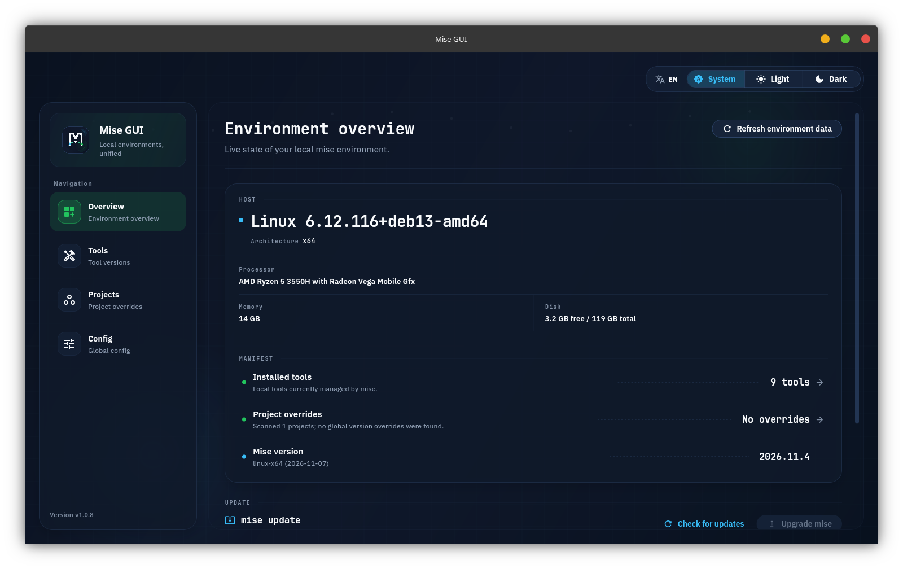
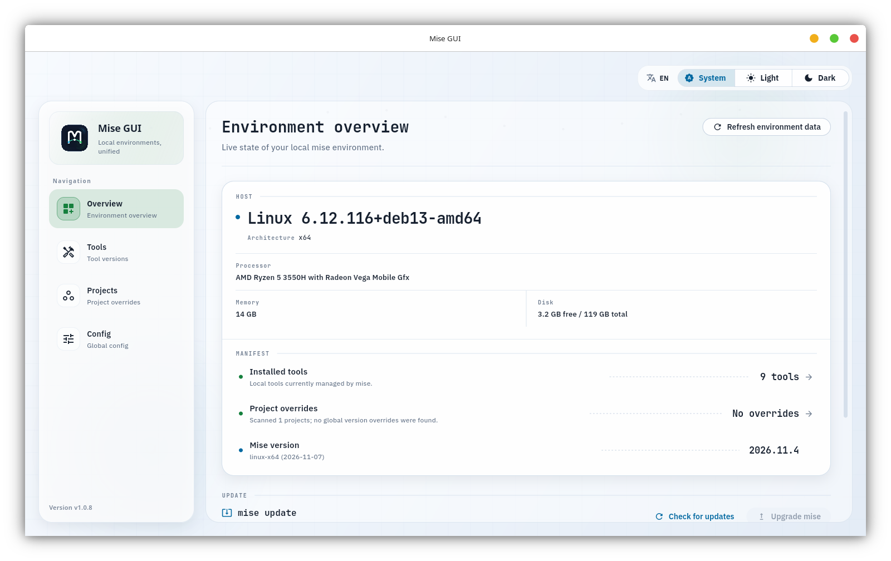

<p align="center">
  
</p>

<h1 align="center">Mise GUI</h1>

<p align="center">
  <strong>A desktop control room for your local mise environment.</strong><br>
  See what is installed, what projects override, and what changed — without reading raw CLI output.
</p>

<p align="center">
  <a href="README.zh.md">简体中文</a> · English
</p>

<p align="center">
  <a href="https://github.com/likaia/mise_gui/releases"></a>
  <a href="https://github.com/likaia/mise_gui/releases"></a>
  <a href="https://github.com/likaia/mise_gui/actions/workflows/ci.yml"></a>
  <a href="LICENSE.txt"></a>
  <a href="https://github.com/likaia/mise_gui/releases"></a>
</p>



## Why Mise GUI

Mise makes it easy to pin tools per project. The hard part is seeing the whole
picture: which versions are active, which projects override the defaults, and
whether the last upgrade actually succeeded.

Mise GUI reads real mise state and puts that picture on one screen. It is built
for developers who move between languages and repositories all day and want to
answer three questions immediately:

- What is installed and active right now?
- Which projects override my global toolchain?
- What happened the last time I ran an operation?

The interface ships in English by default and includes a built-in Simplified
Chinese switch.

## What you can do

| Surface | What it gives you |
| --- | --- |
| **Environment console** | Host details, installed tool count, project overrides, and the mise version in one readable ledger. |
| **Tools** | Current and latest versions per tool, remote version loading, version switching, upgrades, and uninstalls. |
| **Projects** | Multi-directory scanning that highlights projects overriding global defaults. |
| **Config** | Global and project TOML in one context, with a diff preview before saving. |

Operations are explicit. Installs and upgrades move through a command preview
before execution, and every result is recorded with status, duration, and exit
code in Recent activity.

## Light and dark

The console is designed for long sessions in either appearance. Both themes use
the same hairline structure, status dots, and typographic hierarchy.

<p align="center">
  
  
</p>

## Install

1. Install [mise](https://mise.jdx.dev/) if it is not already available:

   ```bash
   # macOS
   brew install mise

   # Windows
   winget install jdx.mise

   # Linux
   curl https://mise.run | sh
   ```

2. Download the latest Mise GUI build for your platform from
   [Releases](https://github.com/likaia/mise_gui/releases).

If mise is missing, the app opens an onboarding screen with the recommended
install command instead of failing silently.

## Local development

The repository pins Flutter through `mise.toml`, so the first command installs
the expected SDK:

```bash
git clone https://github.com/likaia/mise_gui.git
cd mise_gui

mise install
flutter pub get
flutter run -d linux
```

Use the matching desktop target on other platforms:

```bash
flutter run -d macos
flutter run -d windows
```

### Verification

Run the same checks before opening a pull request:

```bash
dart format --output=none --set-exit-if-changed .
flutter analyze
flutter test
npm run deps:check
```

`npm run deps:check` verifies that every direct and transitive dependency is on
a supported stable release. See [AGENTS.md](AGENTS.md) for the dependency and
release rules used by this repository.

## Project structure

```text
lib/
  app/                  # Bootstrap, routing, theme, and application shell
  features/
    dashboard/          # Environment console and recent activity
    tools/              # Versions, install, upgrade, and uninstall flows
    projects/           # Scan directories and project coverage
    config/             # Global and project configuration management
  l10n/                 # English source strings and Chinese translations
  repositories/         # Page-level data aggregation
  services/             # mise CLI, config, history, update, and platform services
  shared/ui/            # Panels, states, dialogs, and preview components
assets/
  branding/             # Application marks
  fonts/                # Bundled IBM Plex Sans and JetBrains Mono faces
scripts/                # Packaging, dependency, and hook scripts
docs/                   # README screenshots and brand assets
```

## Built with

Flutter · Riverpod 3 · go_router · package_info_plus · file_selector

The interface uses bundled [IBM Plex Sans](https://github.com/IBM/plex) and
[JetBrains Mono](https://github.com/JetBrains/JetBrainsMono) faces under the SIL
Open Font License. License texts live in `assets/fonts/`.

## License

This project is licensed under the MIT License. See [LICENSE.txt](LICENSE.txt)
for details.
