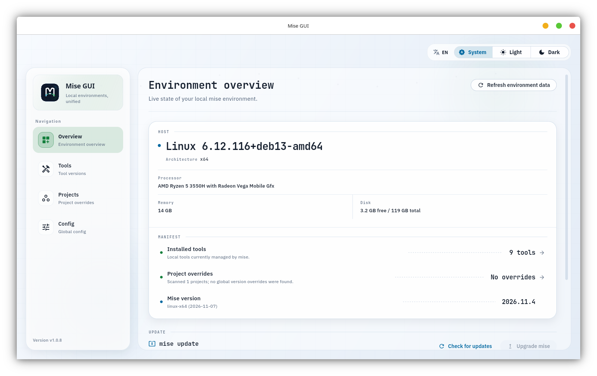
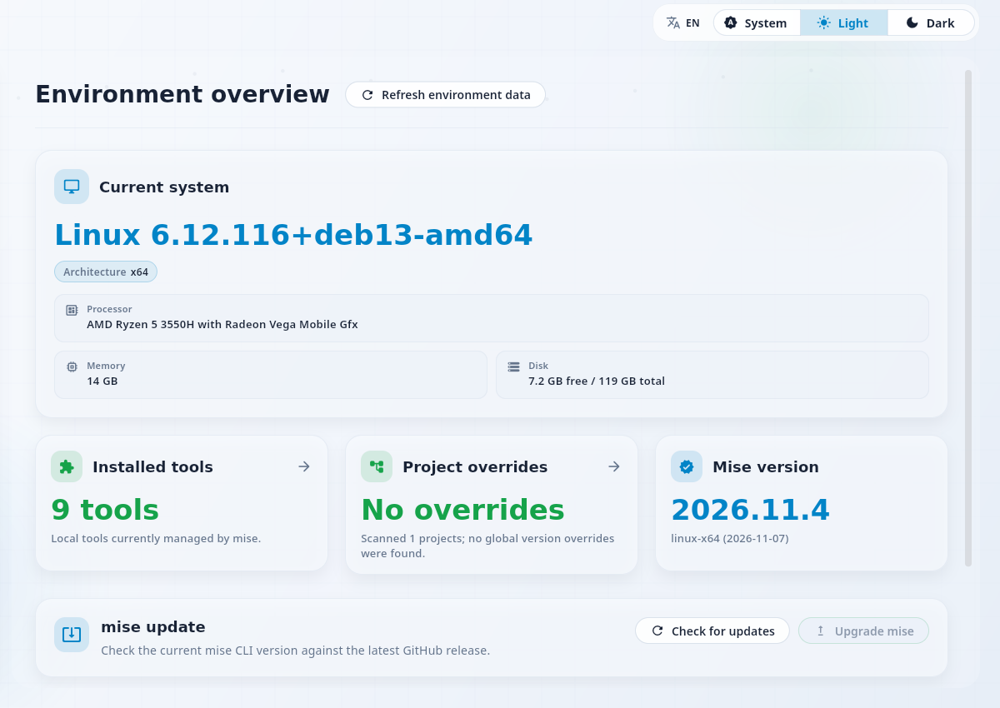
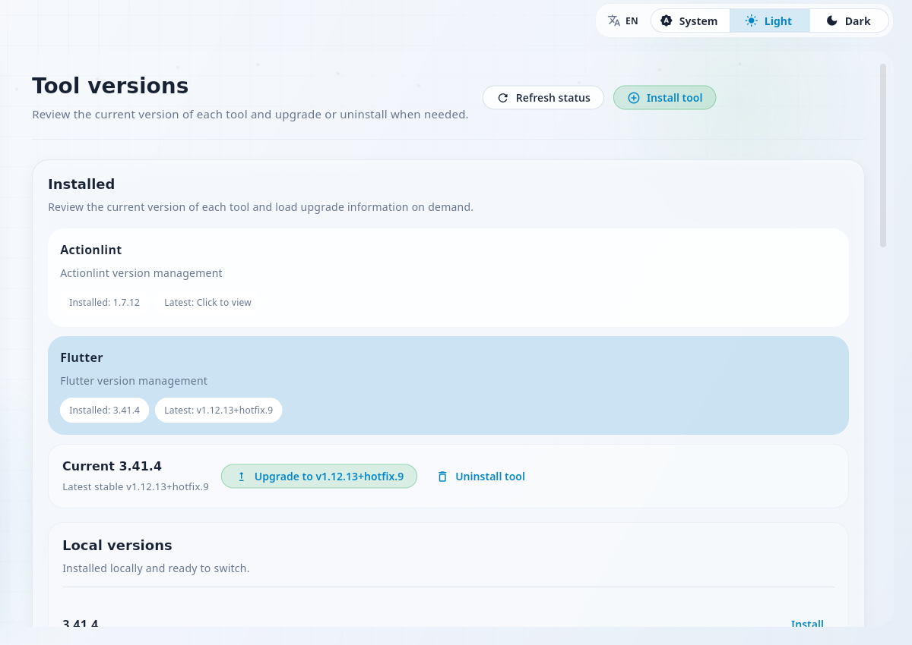
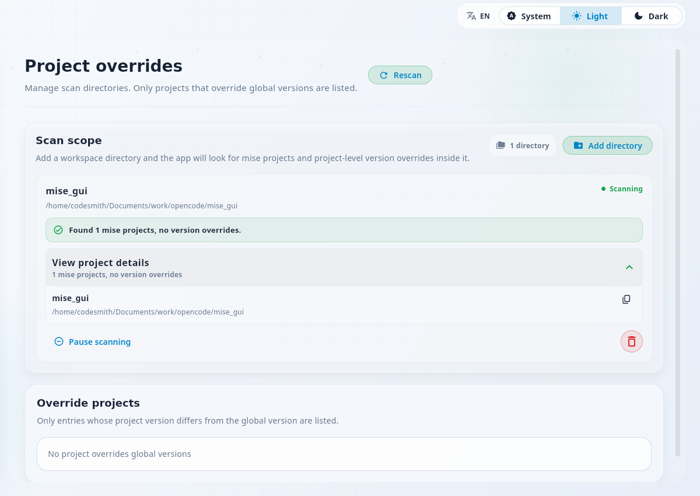
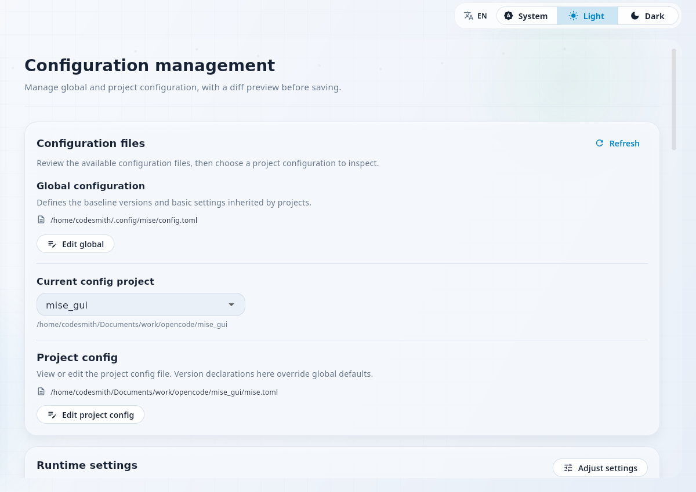

<p align="center">
  
</p>

<h1 align="center">Mise GUI</h1>

<p align="center">
  <strong>本地 mise 环境，一眼看清。</strong><br>
  为 mise 管理的工具链、版本与项目而生的桌面控制台。
</p>

<p align="center">
  <a href="#安装">安装</a> ·
  <a href="#功能一览">功能</a> ·
  <a href="#本地开发">开发</a> ·
  <a href="README.md">English</a>
</p>

<p align="center">
  <a href="https://github.com/likaia/mise_gui/releases"></a>
  <a href="https://github.com/likaia/mise_gui/releases"></a>
  <a href="https://github.com/likaia/mise_gui/releases"></a>
  <a href="LICENSE.txt"></a>
</p>

<br>

<p align="center">
  <picture>
    <source media="(prefers-color-scheme: dark)" srcset="docs/dashboard-dark.png">
    <source media="(prefers-color-scheme: light)" srcset="docs/dashboard-light.png">
    
  </picture>
</p>

## 从全局视角看清环境

mise 让按项目锁定工具链变得简单，真正困难的是看清全貌：当前激活了哪些版本、哪些项目覆盖了全局默认值、上一次升级是否真的成功。

Mise GUI 直接读取真实的 mise 状态，把这张全景图放到同一个界面里。不需要额外的数据库，也没有同步步骤。

<table>
  <tr>
    <td width="33%" valign="top">
      <strong>看见</strong><br><br>
      已安装与正在生效的版本、主机信息、当前 mise 版本，集中在同一份清单里。
    </td>
    <td width="33%" valign="top">
      <strong>追溯</strong><br><br>
      哪些项目覆盖了全局工具链，上一次操作又留下了什么结果。
    </td>
    <td width="33%" valign="top">
      <strong>操作</strong><br><br>
      切换版本、升级 mise、编辑 TOML，执行前都会先展示命令预览。
    </td>
  </tr>
</table>

界面默认使用英文，并内置简体中文切换。

## 功能一览

<table>
  <tr>
    <td width="50%" valign="top">
      
      <br>
      <strong>环境控制台</strong><br>
      <sub>主机信息、已安装工具、项目覆盖和 mise 版本，集中在一处。</sub>
    </td>
    <td width="50%" valign="top">
      
      <br>
      <strong>工具</strong><br>
      <sub>查看每个工具的当前版本与最新版本，加载远端版本，切换、升级或卸载。</sub>
    </td>
  </tr>
  <tr>
    <td width="50%" valign="top">
      
      <br>
      <strong>项目</strong><br>
      <sub>同时扫描多个目录，只标出覆盖全局默认版本的项目。</sub>
    </td>
    <td width="50%" valign="top">
      
      <br>
      <strong>配置</strong><br>
      <sub>在同一上下文中管理全局与项目 TOML，保存前可查看差异预览。</sub>
    </td>
  </tr>
</table>

> **不会有意外的执行。** 安装和升级会先展示完整命令，每次结果都会记录状态、耗时和退出码，并出现在“活动”中。

## 安装

**1 · 安装 mise**（如果还没有）：

| 平台 | 命令 |
| --- | --- |
| macOS | `brew install mise` |
| Windows | `winget install jdx.mise` |
| Linux | `curl https://mise.run \| sh` |

**2 · 下载 Mise GUI**：前往
[Releases](https://github.com/likaia/mise_gui/releases) 获取适用于当前系统的最新版本。

如果检测不到 mise，应用会进入引导页并给出推荐的安装命令，而不是静默失败。

## 本地开发

仓库通过 `mise.toml` 固定 Flutter 版本，因此第一条命令会安装预期的 SDK：

```bash
git clone https://github.com/likaia/mise_gui.git
cd mise_gui

mise install
flutter pub get
flutter run -d linux   # 或：macos / windows
```

提交 Pull Request 前，请运行与 CI 一致的检查：

```bash
dart format --output=none --set-exit-if-changed .
flutter analyze
flutter test
npm run deps:check
```

`npm run deps:check` 会确认所有直接依赖和传递依赖都处于受支持的稳定版本。CI 会在面向 `master` 的 Pull Request 上运行同样的检查。依赖与发布规则见 [AGENTS.md](AGENTS.md)。

<details>
<summary><strong>项目结构</strong></summary>

```text
lib/
  app/                  # 启动、路由、主题和应用外壳
  features/
    dashboard/          # 环境控制台与活动
    tools/              # 版本、安装、升级和卸载流程
    projects/           # 扫描目录与项目覆盖
    config/             # 全局及项目配置管理
  l10n/                 # 英文源文案与中文翻译
  repositories/         # 页面级数据聚合
  services/             # mise CLI、配置、历史、更新和平台服务
  shared/ui/            # 通用面板、状态、对话框和预览组件
assets/
  branding/             # 应用标志
  fonts/                # 内置 IBM Plex Sans 与 JetBrains Mono 字体
scripts/                # 打包、依赖与 Git Hook 脚本
docs/                   # README 截图与品牌素材
```

</details>

<details>
<summary><strong>设计细节</strong></summary>

- **外观** —— 浅色、深色与跟随系统三种模式共用同一套细线结构、状态色和排版层级。
- **字体** —— 内置 [IBM Plex Sans](https://github.com/IBM/plex) 与
  [JetBrains Mono](https://github.com/JetBrains/JetBrainsMono)，均遵循 SIL Open Font License，许可文本位于 `assets/fonts/`。
- **语言** —— 英文源文案搭配完整的中文翻译，并由测试校验覆盖率与占位符。
- **技术栈** —— Flutter · Riverpod 3 · go_router · file_selector ·
  package_info_plus。

</details>

## 开源协议

本项目使用 MIT 协议，详情请见 [LICENSE.txt](LICENSE.txt)。

---

<p align="center">
  <sub>使用 Flutter 构建 · 阅读 <a href="README.md">English README</a></sub>
</p>
