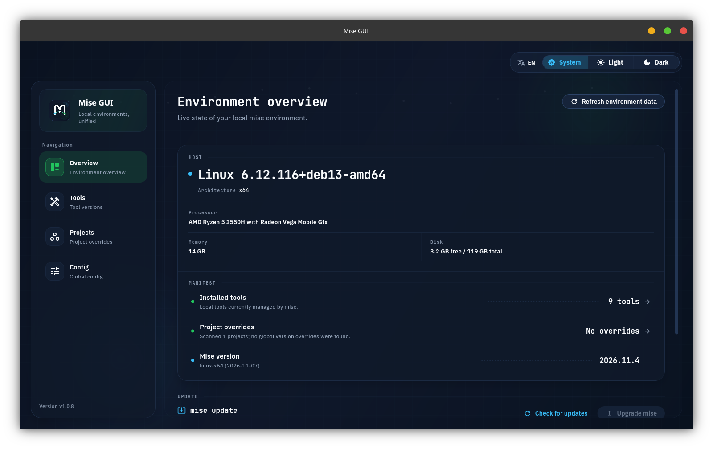

<p align="center">
  
</p>

<h1 align="center">Mise GUI</h1>

<p align="center">
  <strong>本地 mise 环境的桌面控制台。</strong><br>
  已安装哪些工具、哪些项目覆盖了全局版本、最近一次操作结果如何，一眼看清。
</p>

<p align="center">
  <a href="README.md">English</a> · 简体中文
</p>

<p align="center">
  <a href="https://github.com/likaia/mise_gui/releases"></a>
  <a href="https://github.com/likaia/mise_gui/releases"></a>
  <a href="https://github.com/likaia/mise_gui/actions/workflows/ci.yml"></a>
  <a href="LICENSE.txt"></a>
  <a href="https://github.com/likaia/mise_gui/releases"></a>
</p>



## 为什么选择 Mise GUI

mise 让按项目锁定工具版本变得简单，真正困难的是看清全貌：当前激活了哪些版本、哪些项目覆盖了全局默认值、上一次升级是否成功。

Mise GUI 直接读取真实的 mise 状态，把这张全景图放到同一个界面里。它面向每天在多语言、多仓库之间切换的开发者，帮助你立刻回答三个问题：

- 当前安装了哪些工具，哪些版本正在生效？
- 哪些项目覆盖了全局工具链？
- 上一次执行的操作结果如何？

界面默认使用英文，可在顶部随时切换为简体中文。

## 主要能力

| 模块 | 作用 |
| --- | --- |
| **环境控制台** | 在一个清单里集中展示主机信息、已安装工具数量、项目覆盖和 mise 版本。 |
| **工具** | 查看每个工具的当前版本与最新版本，加载远端版本，切换、升级或卸载。 |
| **项目** | 同时扫描多个目录，单独标出覆盖全局默认版本的项目。 |
| **配置** | 在同一上下文中管理全局与项目 TOML，保存前可查看差异预览。 |

所有操作都是显式的。安装和升级会先展示命令预览，再进入执行；每次结果都会记录状态、耗时和退出码，并出现在“最近活动”中。

## 深色与浅色

无论长时间使用哪种外观，控制台都保持同一套细线结构、状态圆点和排版层级。

<p align="center">
  
  
</p>

## 安装

1. 如果还没有安装 [mise](https://mise.jdx.dev/)，先执行对应平台的安装命令：

   ```bash
   # macOS
   brew install mise

   # Windows
   winget install jdx.mise

   # Linux
   curl https://mise.run | sh
   ```

2. 前往 [Releases](https://github.com/likaia/mise_gui/releases) 下载适用于当前系统的最新版本。

如果检测不到 mise，应用会进入引导页并给出推荐的安装命令，而不是静默失败。

## 本地开发

仓库通过 `mise.toml` 固定 Flutter 版本，因此第一条命令会安装预期的 SDK：

```bash
git clone https://github.com/likaia/mise_gui.git
cd mise_gui

mise install
flutter pub get
flutter run -d linux
```

其他桌面平台可以替换运行目标：

```bash
flutter run -d macos
flutter run -d windows
```

### 提交前检查

提交 Pull Request 前，请运行与 CI 一致的检查：

```bash
dart format --output=none --set-exit-if-changed .
flutter analyze
flutter test
npm run deps:check
```

`npm run deps:check` 会确认所有直接依赖和传递依赖都处于受支持的稳定版本。依赖与发布规则见 [AGENTS.md](AGENTS.md)。

## 项目结构

```text
lib/
  app/                  # 启动、路由、主题和应用外壳
  features/
    dashboard/          # 环境控制台与最近活动
    tools/              # 版本、安装、升级和卸载流程
    projects/           # 扫描目录与项目覆盖
    config/             # 全局及项目配置管理
  l10n/                 # 英文源文案与中文翻译
  repositories/         # 页面级数据聚合
  services/             # mise CLI、配置、历史、更新和平台服务
  shared/ui/            # 通用面板、状态、对话框和预览组件
assets/
  branding/             # 应用标志
  fonts/                # 内置 IBM Plex Sans 与 JetBrains Mono 字体
scripts/                # 打包、依赖与 Git Hook 脚本
docs/                   # README 截图与品牌素材
```

## 技术栈

Flutter · Riverpod 3 · go_router · package_info_plus · file_selector

界面内置 [IBM Plex Sans](https://github.com/IBM/plex) 与
[JetBrains Mono](https://github.com/JetBrains/JetBrainsMono) 字体，均遵循 SIL Open Font License，许可文本位于 `assets/fonts/`。

## 开源协议

本项目使用 MIT 协议，详情请见 [LICENSE.txt](LICENSE.txt)。
